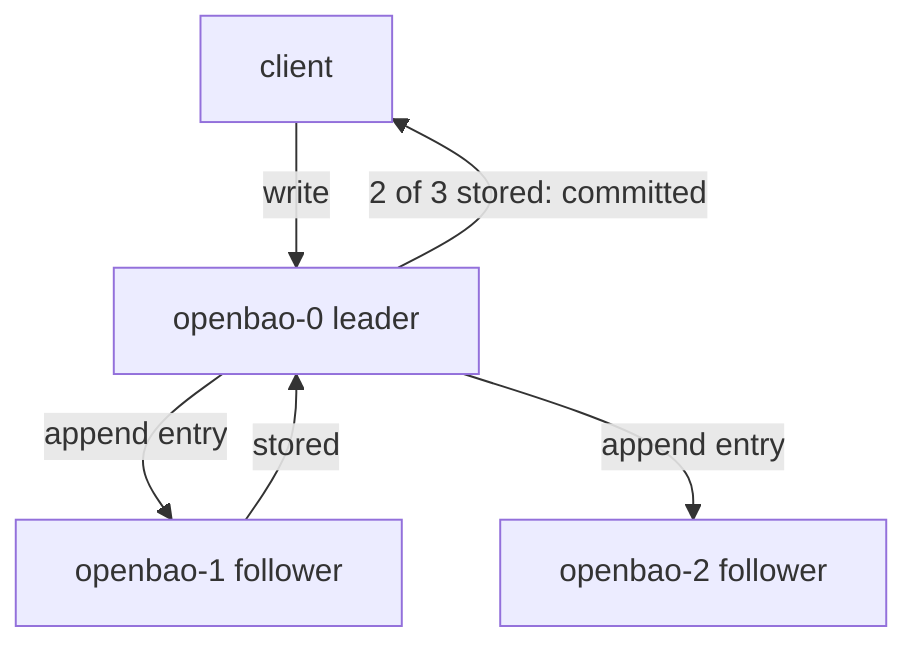

# Raft, Voters And Quorum

Three copies of the data do not make a cluster on their own. The copies must agree on every change, in the same order, even when a node is slow or gone. This part looks at the running cluster in your playground and explains how Integrated Storage reaches that agreement, and how many nodes can fail before it cannot.

## One leader, many copies

Integrated Storage is OpenBao's built-in storage backend. Each OpenBao node writes its data to a local folder, here `/openbao/data` on the pod's volume. The nodes keep those folders identical with the Raft consensus protocol, a set of rules that lets a group of servers agree on one ordered log of changes.

Raft gives one node a special role. The **leader** accepts every write, appends it to its log and sends it to the other nodes, the **followers**. In OpenBao the Raft leader is also the **active node**: the node that does the actual OpenBao work. The followers are **standby nodes**. They keep their copy current and take over if the leader goes away.

Start by looking at the cluster from your machine. Open a second terminal and start a port-forward to the leader, then point the `bao` CLI at it with the lab-only root token:

<!-- astrona:playground:renew -->

```sh
kubectl -n openbao port-forward svc/openbao-active 8200:8200
```

```sh
export BAO_ADDR=http://openbao.localtest.me:8200
export BAO_TOKEN=$(kubectl -n openbao get secret openbao-init -o jsonpath='{.data.root-token}' | base64 -d)
bao operator raft list-peers
```

The command prints one row per node. Each row has a node ID (here the pod name, because the chart sets the Raft node ID to the pod name), the node's cluster address on port `8201`, its state, and whether it is a voter. One row says `leader`; the other two say `follower`. All three say `true` in the voter column.

## Voters and quorum

A **voter** is a node that takes part in decisions. When the leader sends a write, it waits until a majority of voters, itself included, has stored it. Only then is the write committed and the client gets a response. That majority is the **quorum**:

| Voters | Quorum | Failures it survives |
| --- | --- | --- |
| 1 | 1 | 0 |
| 3 | 2 | 1 |
| 5 | 3 | 2 |
| 4 | 3 | 1 |

The quorum is `(voters / 2) + 1`, rounded down. The table shows why clusters have an odd number of voters: four voters survive one failure, exactly like three, but need one more node to agree on every write.

The same rule decides elections. When the followers stop hearing from the leader, one of them asks the others for votes and becomes leader when a quorum agrees. Without a quorum, no node can become leader and no write can be committed.



The diagram shows a write being committed as soon as the leader and one follower have stored it; the third node catches up later.

A node can also be a **non-voter**. It receives the data but does not vote and cannot become leader. New nodes start as non-voters until they are healthy, and some teams add non-voters to spread read load without changing the quorum.

## Reading the cluster's health

`list-peers` shows who is in the cluster. Autopilot, the part of Integrated Storage that watches node health, shows how well they are doing:

```sh
bao operator raft autopilot state
```

The output says whether the cluster is healthy and gives its **failure tolerance**: how many voters can fail before quorum is lost. With three healthy voters, it is `1`. Below that, one block per node shows its status, whether it is a voter, the index of the last log entry it holds, and when it last heard from the leader.

The same facts come back from the HTTP API, which is what scripts and monitoring use. `bao status` on any node also names the active node:

```sh
bao status
```

Look for the line `HA Enabled`, which is `true`, and `Active Node Address`, which is the leader's address. The `Raft Committed Index` and `Raft Applied Index` lines show how far this node's log has come.

You now know that one leader accepts writes, that a write needs a quorum of voters, and that three voters survive one failure. You can see all of this with `list-peers`, `autopilot state` and `bao status`. The open question is how a node becomes part of the cluster in the first place.

## Common pitfalls

> [!WARNING]
> - **Counting pods instead of voters.** Quorum is a majority of the voters in the Raft configuration, not of the pods that run. A node that left the pod list but stayed in the configuration still counts.
> - **Adding a fourth node to be safer.** Four voters survive one failure, the same as three, and every write needs one more node to agree.
> - **Expecting a lone survivor to keep working.** One node of three has all the data but no quorum. It cannot become leader or commit a write.
> - **Reading `list-peers` from a sealed node.** A sealed node answers almost nothing. Ask the active node through `openbao-active`.
