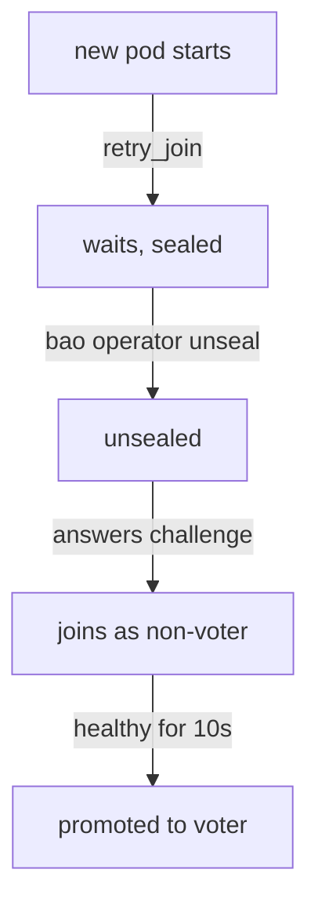

# Joining Nodes And Autopilot

A new OpenBao pod starts with an empty data folder. Before it can serve anything, it must find the cluster, ask to join, receive the data and become a voter. This part shows how `retry_join` makes the first step automatic, why a Shamir-sealed node still waits for you, and how autopilot decides when a new node may vote and when a dead one is removed.

## How a node finds the cluster

The server configuration of every pod in your playground has the same `storage` block. The Helm chart writes it to a ConfigMap, and each pod reads it at start. Look at it:

<!-- astrona:playground:renew -->

```sh
kubectl -n openbao get configmap openbao-config -o jsonpath='{.data.extraconfig-from-values\.hcl}'
```

The `storage "raft"` block names the data path and has three `retry_join` blocks, one per pod:

```hcl
storage "raft" {
  path = "/openbao/data"

  retry_join {
    leader_api_addr = "http://openbao-0.openbao-internal:8200"
  }
  retry_join {
    leader_api_addr = "http://openbao-1.openbao-internal:8200"
  }
  retry_join {
    leader_api_addr = "http://openbao-2.openbao-internal:8200"
  }
}
```

A `retry_join` block tells a node where it may find the cluster. A node that has no Raft data yet tries each `leader_api_addr` in turn, keeps retrying, and joins through the first one that answers as an active node. The addresses use the headless Service `openbao-internal`, which gives each pod of the StatefulSet a stable DNS name. Because the same list is in every pod, any pod can join through any other.

If the ConfigMap name differs on your cluster, list the ConfigMaps with `kubectl -n openbao get configmap` and pick the one whose name ends in `-config`.

## Why a sealed node waits

Joining is not only a network step. The leader hands the new node an encrypted challenge, and the new node must decrypt it with the cluster's keys to prove it belongs. With the Shamir seal, a freshly started node does not have those keys yet. So the sequence for a Shamir cluster is:



The diagram shows that the unseal step sits in the middle of joining: until someone unseals the new pod, it never appears in `list-peers`.

You run commands inside a pod with a small helper. It passes the root token explicitly and talks to the pod's own listener:

```sh
export BAO_TOKEN=$(kubectl -n openbao get secret openbao-init -o jsonpath='{.data.root-token}' | base64 -d)
bao_on() { pod=$1; shift; kubectl -n openbao exec -i "$pod" -- env BAO_ADDR=http://127.0.0.1:8200 BAO_TOKEN="$BAO_TOKEN" bao "$@"; }
bao_on openbao-2 status
```

On a healthy cluster every pod reports `Sealed false`. To see the waiting step, restart one pod. The StatefulSet creates a new pod with the same name and the same volume, and the Shamir seal makes it start sealed:

```sh
kubectl -n openbao delete pod openbao-2
kubectl -n openbao get pods -w
```

The new `openbao-2` shows `0/1` in the `READY` column. The chart's readiness check fails while a node is sealed, so this is expected. Press Ctrl-C once it runs, then unseal it with the lab-only key:

```sh
bao_on openbao-2 operator unseal "$(kubectl -n openbao get secret openbao-init -o jsonpath='{.data.unseal-key}' | base64 -d)"
```

The pod already had Raft data, so it rejoined at once; a pod with an empty volume would now join as described above. Run `bao operator raft list-peers` again: `openbao-2` is back as a voter.

## Autopilot

Autopilot is the part of Integrated Storage that manages voters for you. It promotes a new node from non-voter to voter once the node has been healthy for the **server stabilization time**, 10 seconds by default. It marks a node unhealthy when it falls more than 1000 log entries behind or has not heard from the leader for 10 seconds. And it can remove dead servers from the configuration, but only when you ask it to. Read the current settings:

```sh
bao operator raft autopilot get-config
```

By default `cleanup_dead_servers` is `false`. A node that disappears for good, for example because the StatefulSet was scaled down, stays in the Raft configuration as a voter. It still counts toward the quorum, so the cluster tolerates one fewer failure than you think. Turn cleanup on with three settings that belong together:

```sh
bao operator raft autopilot set-config \
  -cleanup-dead-servers=true \
  -min-quorum=3 \
  -dead-server-last-contact-threshold=10m
```

`-min-quorum` is required with cleanup: autopilot never removes servers below this number, so a short outage of two nodes cannot shrink the cluster to one. Set it to the number of voters you expect. `-dead-server-last-contact-threshold` is how long a node must be silent before autopilot calls it dead; the default is 24 hours. A node that autopilot removed cannot rejoin with its old data: it must start empty.

You now know how a node joins (`retry_join`, then unseal, then promotion by autopilot) and how to make autopilot clean up dead servers safely. The open question is what the cluster does at the moment the leader disappears.

## Common pitfalls

> [!WARNING]
> - **Waiting for a sealed node to join.** With the Shamir seal, `retry_join` alone is not enough. Unseal the node with the cluster's key.
> - **Turning on cleanup without `-min-quorum`.** OpenBao refuses it, and for a good reason: without a floor, autopilot could remove healthy but briefly unreachable voters.
> - **A very short dead-server threshold.** A node that restarts slowly can be removed and must then start with an empty volume. Minutes, not seconds.
> - **Reading the wrong ConfigMap.** The chart stores the server configuration in a ConfigMap whose name ends in `-config`; the file inside is generated from the Helm values.

## Your mission: Join The Third Node And Configure Autopilot

You can now see why a node is missing from the cluster, bring it in, and set up autopilot. The graded lab gives you a cluster where one pod never joined, and asks you to make it a voter and configure autopilot so the cluster survives the loss of its leader.

The lab runs in its own cluster, so first pause your playground. Nothing in it is lost:

```sh
astrona stop ats-117-playground-010-01
```

Then start the lab:

```sh
astrona run --git ssh://git@github.com/astrona-io/ATS117.git -c sections/section-010/module-01/labs/lab-01
```

The task is on the next page. Solve it on your own first. When you think you are done, send it for grading:

```sh
astrona submit -c sections/section-010/module-01/labs/lab-01
```

When the lab is done, remove it and start your playground again:

```sh
astrona destroy ats-117-lab-010-01
astrona start ats-117-playground-010-01
```
