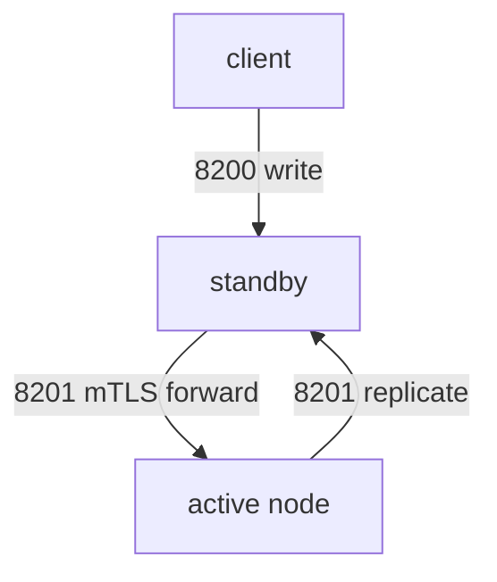

# Addresses, Request Forwarding And The Cluster Port

Every node in a cluster must tell clients and other nodes where it can be reached. If these addresses are wrong, a standby cannot forward a write and a client is sent to an address it cannot open. This part shows the two addresses a node advertises, the port that nodes use to talk to each other, and what a standby does with a request it cannot serve itself.

## The two addresses of a node

A node advertises two addresses. The **API address** (`api_addr`) is the URL where clients reach the node on port `8200`. The **cluster address** (`cluster_addr`) is the URL where other nodes reach it on port `8201`, the cluster port. The standbys use the active node's cluster address to forward requests. Clients that a standby redirects use the active node's API address.

The Helm chart sets both from environment variables. Look at them in a pod:

<!-- astrona:playground:renew -->

```sh
kubectl -n openbao exec openbao-0 -- env | grep -E 'BAO_(API|CLUSTER)_ADDR'
```

The API address is built from the IP address of the pod and the cluster address from the DNS name of the pod in the headless Service `openbao-internal`. Now ask a standby which active node it knows:

```sh
export BAO_TOKEN=$(kubectl -n openbao get secret openbao-init -o jsonpath='{.data.root-token}' | base64 -d)
bao_on() { pod=$1; shift; kubectl -n openbao exec -i "$pod" -- env BAO_ADDR=http://127.0.0.1:8200 BAO_TOKEN="$BAO_TOKEN" bao "$@"; }
bao_on openbao-1 status
```

The fields `HA Mode`, `Active Node Address` and `Raft Committed Index` describe the cluster as this node sees it. On a standby, `HA Mode` is `standby` and `Active Node Address` is the API address of the leader.

## How a standby handles a request

A standby that receives a request has two ways to answer. By default it **forwards** a write to the active node over the cluster port and returns the active node's response, so the client never notices. Since v2.5.0 a standby also answers requests that only read from its own copy of the data.

The second way is a **redirect**: the standby answers with HTTP status `307` and a `Location` header that holds the active node's API address, and the client sends the request again to that address. A client can ask for this behaviour with the request header `X-Vault-No-Request-Forwarding: 1`. Try both on a write. First find the pod that is a standby with `list-peers`, then send the write to it:

```sh
bao_on openbao-0 operator raft list-peers
kubectl -n clients exec -i deploy/tester -- curl -s -o /dev/null -w '%{http_code}\n' \
  -X PUT -H "X-Vault-Token: $BAO_TOKEN" -d '{"data":{"a":"b"}}' \
  http://openbao-1.openbao-internal.openbao.svc.cluster.local:8200/v1/secret/data/platform/forward-test
```

If `openbao-1` is a standby, the write succeeds with status `200`, because the standby forwarded it. Add the header `-H "X-Vault-No-Request-Forwarding: 1"` to the same command and the standby answers `307` instead. If `openbao-1` is the leader, pick another pod.

## The cluster port

Forwarding uses the cluster port `8201`. Nodes talk over it with mutual TLS (mTLS), meaning both sides present a certificate. The active node creates the certificates itself and stores them in the barrier, so you do not manage them, and they are separate from the TLS certificate of the API listener on port `8200`.



The diagram shows that a client talks to any node on `8200`, while the nodes talk to each other on `8201`.

You can see the port in the Service that gives each pod its DNS name:

```sh
kubectl -n openbao get service openbao-internal -o jsonpath='{.spec.ports[*].port}{"\n"}'
```

The Service lists `8200` for the API and `8201` for the cluster port. A NetworkPolicy or firewall that blocks `8201` between pods breaks forwarding and Raft replication, even though `8200` still answers.

You now know which two addresses a node advertises, how a standby forwards or redirects a request, and which port the nodes use between themselves. The next question is how to add a node to a cluster that already runs.

## Common pitfalls

> [!WARNING]
> - **Blocking port `8201` between nodes.** Clients still reach every node on `8200`, but writes through a standby and Raft replication fail.
> - **A wrong `api_addr`.** Redirected clients and some tools receive an address they cannot reach.
> - **Using the pod IP as a stable address.** It changes when a pod restarts. Use the DNS names of the headless Service where the configuration allows it.
> - **Treating a `307` as an error.** It is a redirect to the active node; a client that follows redirects handles it.
