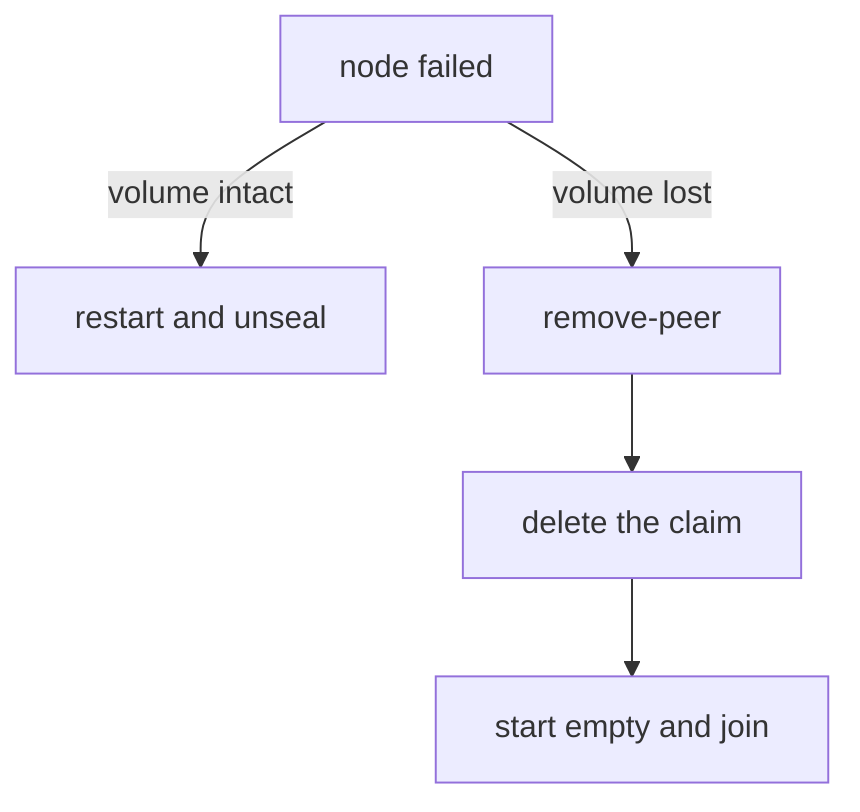

# Removing And Replacing Nodes

Scaling a StatefulSet down is one command, and it is the easiest way to damage a Raft cluster. The pod disappears, but the Raft configuration still lists it as a voter, so the quorum is calculated with a node that will never answer. This part removes the fourth pod in the correct order and explains how to replace a failed node.

## Remove from Raft first

Remember what `list-peers` says in the playground after the previous part: four voters. To retire `openbao-3`, tell Raft first. The command runs on any unsealed node and is forwarded to the leader:

<!-- astrona:playground:renew -->

```sh
export BAO_TOKEN=$(kubectl -n openbao get secret openbao-init -o jsonpath='{.data.root-token}' | base64 -d)
bao_on() { pod=$1; shift; kubectl -n openbao exec -i "$pod" -- env BAO_ADDR=http://127.0.0.1:8200 BAO_TOKEN="$BAO_TOKEN" bao "$@"; }
bao_on openbao-0 operator raft remove-peer openbao-3
bao_on openbao-0 operator raft list-peers
```

The peer is gone from the configuration, and the quorum is two of three again. Only now scale the StatefulSet down:

```sh
helm upgrade openbao openbao/openbao --version 0.30.4 -n openbao --reuse-values --set server.ha.replicas=3
```

The order matters. If you scale down first, the cluster has four voters and one is dead. The quorum stays three, so the cluster tolerates no more failures, and `autopilot state` reports that it is unhealthy.

## Clean up the volume

Scaling down does not delete the PersistentVolumeClaim of the removed pod. It keeps the old Raft data. A node that was removed from the configuration must start empty if it ever joins again, so delete the claim when the node is gone for good:

```sh
kubectl -n openbao get pvc
kubectl -n openbao delete pvc data-openbao-3
```

Run the first command to confirm the claim name before you delete anything. Deleting a claim destroys that volume, so do it only for a node that is already removed from Raft.

## Replacing a failed node

A node can fail in two ways. If its volume is intact, restart the pod and unseal it: it rejoins with its data. If the volume is lost, the node ID is still in the configuration as a voter. Remove it with `remove-peer`, delete the old claim, and let the pod start again with an empty volume. It then joins like a new node.



The diagram shows that the state of the volume decides which of the two repairs applies.

Autopilot can do the removal for you. With `cleanup_dead_servers` on, it removes a server after the dead-server threshold, but never below `min_quorum`. Use it as a safety net, not as the normal procedure, because a manual `remove-peer` is faster and you choose the moment.

You now know the safe order for retiring a node (Raft first, then the pod, then the volume) and how to replace one. A cluster also depends on the storage settings and disks under it.

## Common pitfalls

> [!WARNING]
> - **Scaling down before `remove-peer`.** A dead voter stays in the quorum calculation.
> - **Deleting the claim before the peer is removed.** The node then fails in the middle of a still active configuration.
> - **Reusing an old volume for a removed node.** A removed node must start empty.
> - **Removing a healthy voter from a three-node cluster.** Two voters tolerate no failure.

## Your mission: Retire A Node And Keep Quorum Safe

You can now remove a node from Raft, scale the pods down and clean up the volume. The graded lab gives you a cluster where a fourth node was scaled away without Raft being told. You remove the dead peer and its volume, and leave the cluster healthy.

The lab runs in its own cluster, so first pause your playground. Nothing in it is lost:

```sh
astrona stop ats-117-playground-010-02
```

Then start the lab:

```sh
astrona run --git ssh://git@github.com/astrona-io/ATS117.git -c sections/section-010/module-02/labs/lab-01
```

The task is on the next page. Solve it on your own first. When you think you are done, send it for grading:

```sh
astrona submit -c sections/section-010/module-02/labs/lab-01
```

When the lab is done, remove it and start your playground again:

```sh
astrona destroy ats-117-lab-010-02
astrona start ats-117-playground-010-02
```
