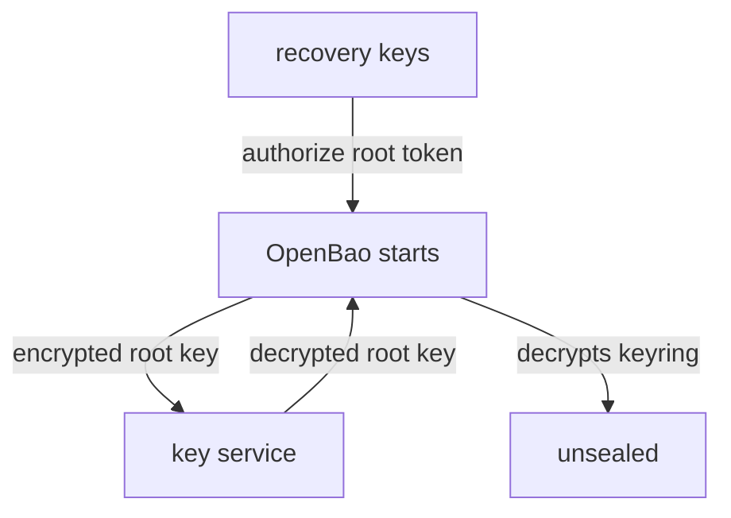

# Seals, Auto-Unseal And Recovery Keys

Before you change how a cluster unseals, you need to know exactly what the seal protects and what each kind of key can still do afterwards. This part looks at the Shamir seal of your playground cluster and at the static seal of the unsealer, and then sets out the seals OpenBao 2.7 offers.

## What the seal protects

OpenBao encrypts everything it writes to storage. The encryption keys are in a keyring, the keyring is encrypted with the **root key**, and the root key is protected by the **seal**. A sealed server has its data but not the root key, so it cannot read anything. Unsealing means getting the root key into memory.

With the **Shamir seal**, the root key is split into key shares when the cluster is initialized. Unsealing means entering enough shares to rebuild it. Look at the cluster's seal:

<!-- astrona:playground:renew -->

```sh
export BAO_TOKEN=$(kubectl -n openbao get secret openbao-init -o jsonpath='{.data.root-token}' | base64 -d)
bao_on() { pod=$1; shift; kubectl -n openbao exec -i "$pod" -- env BAO_ADDR=http://127.0.0.1:8200 BAO_TOKEN="$BAO_TOKEN" bao "$@"; }
bao_on openbao-0 status
```

The `Seal Type` line says `shamir`, and `Total Shares` and `Threshold` say `1`: the lab-only setup. A real cluster uses at least three shares with a threshold above one.

## What auto-unseal changes

With **auto-unseal**, a key service holds a key that encrypts OpenBao's root key. At start, OpenBao sends the encrypted root key to the service, gets it back decrypted, and unseals without anyone. The unsealer in your playground does this with the static seal:

```sh
kubectl -n unsealer exec -i unsealer-0 -- env BAO_ADDR=http://127.0.0.1:8200 bao status
```

Its `Seal Type` is `static`, and instead of `Total Shares` it shows `Recovery Seal Type` and recovery share counts. That is the second change. When a cluster is initialized with auto-unseal, `bao operator init` creates **recovery keys** instead of unseal keys. Recovery keys cannot unseal: the key service does that. They authorize a few operations that need more than a token, such as generating a new root token. Lose the key service and the recovery keys cannot bring the data back.



The diagram shows that the key service does the unsealing, while recovery keys only authorize special operations.

## The seals in OpenBao 2.7

OpenBao builds four seal mechanisms into the server binary. Since v2.7.0, the vendor-specific cloud seals are no longer built in; they are external KMS plugins from the `openbao-plugins` collection.

| Seal | Built in or plugin | Key service |
| --- | --- | --- |
| `shamir` | Built in | People with key shares |
| `transit` | Built in | The Transit engine of another OpenBao server |
| `static` | Built in | A 32-byte key from the configuration, an environment variable (`env://`) or a file (`file://`) |
| `kmip` | Built in | A KMIP key server |
| `awskms`, `gcpckms`, `azurekeyvault`, `ocikms`, `alicloudkms`, `pkcs11` and others | Plugin | A cloud key management service or a hardware security module (HSM) |

A plugin seal needs a `plugin "kms"` block next to the `seal` block, and the plugin binary must be on the server. For example, for AWS Key Management Service:

```hcl
plugin "kms" "awskms" {
  command = "openbao-plugin-kms-awskms"
}

seal "awskms" {
  region     = "eu-west-1"
  kms_key_id = "19ec80b0-dfdd-4d97-8164-c6examplekey"
}
```

The name in the `seal` block must match the name in the `plugin` block. The credentials come from the usual AWS sources, such as an IAM role for the pod, not from the file. The other cloud seals follow the same pattern with their own fields, for example `project`, `region`, `key_ring` and `crypto_key` for Google Cloud KMS.

The static seal looks simple, but the OpenBao documentation warns about it: the key is only as safe as the place it comes from. It fits when another secrets manager already holds the key and injects it. The lab uses it for the unsealer so that no cloud account is needed.

You now know that the seal protects the root key, that auto-unseal moves the unseal step to a key service, and that the key shares become recovery keys. You also know which seals are built in. The open question is how the Transit seal is set up, since that is the one the cluster will use.

## Common pitfalls

> [!WARNING]
> - **Treating recovery keys as a backup of the key service.** They cannot unseal. If the key service and its key are gone, the data is gone.
> - **Configuring `seal "awskms"` on 2.7 without the plugin.** The cloud seals are plugins since v2.7.0; the server needs the `plugin "kms"` block and the binary.
> - **Using the static seal with the key in the configuration file.** Anyone who reads the file can unseal the data. Inject the key from a secrets manager.
> - **Forgetting the key service in disaster recovery plans.** A restored snapshot is useless without the key that decrypts it.
