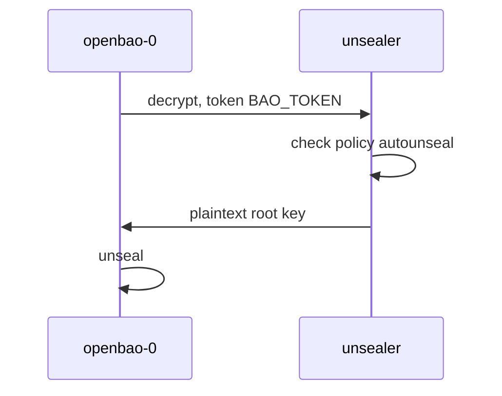

# The Transit Seal

The Transit seal lets one OpenBao server unseal another. The cluster sends its encrypted root key to the Transit secrets engine of a second server, the unsealer, and gets it back decrypted. This part looks at what the unsealer in your playground already has, and at the three choices that decide whether the seal keeps working: the key, the policy and the token.

## The key and the policy

The Transit secrets engine encrypts and decrypts data with named keys and never hands the keys out. The unsealer has the engine at `transit/` and one key, `autounseal`. Set up a helper for the unsealer and read the key:

<!-- astrona:playground:renew -->

```sh
export UNSEALER_TOKEN=$(kubectl -n unsealer get secret unsealer-init -o jsonpath='{.data.root-token}' | base64 -d)
unsealer_bao() { kubectl -n unsealer exec -i unsealer-0 -- env BAO_ADDR=http://127.0.0.1:8200 BAO_TOKEN="$UNSEALER_TOKEN" bao "$@"; }
unsealer_bao read transit/keys/autounseal
```

The output shows the key type and its versions. The seal uses the latest version to encrypt and keeps older versions to decrypt older data. The OpenBao documentation says the key may be rotated with the Transit rotate endpoint, but old versions must never be disabled or deleted: the cluster's root key may still be encrypted with them.

The cluster needs exactly two capabilities on that key. Read the policy:

```sh
unsealer_bao policy read autounseal
```

It allows `update` on `transit/encrypt/autounseal` and `transit/decrypt/autounseal`, and nothing else. A token with this policy can unseal the cluster, but it cannot read other secrets on the unsealer, create keys or delete this one.

## The token

The token is where Transit seals usually break. The OpenBao documentation gives two rules. The token should be an **orphan token**, a token with no parent, so that revoking the token that created it does not revoke it too. And it should be a **periodic token** without an explicit maximum TTL, so the cluster can renew it for ever. Look at the token the bootstrap created:

```sh
SEAL_TOKEN=$(kubectl -n openbao get secret transit-seal-token -o jsonpath='{.data.token}' | base64 -d)
unsealer_bao token lookup "$SEAL_TOKEN"
```

Check three lines: `orphan` is `true`, `period` is `24h`, and `policies` lists `autounseal` and `default`. The cluster renews the token while it runs, so a 24-hour period is enough as long as no node is down for a whole day. A token like this was created with:

```sh
unsealer_bao token create -orphan -period=24h -policy=autounseal
```

You do not need to run that now: the playground already has one.

## The seal block and the Helm chart

The cluster's configuration gets a `seal "transit"` block. The address is the unsealer's Service inside the cluster:

```hcl
seal "transit" {
  address    = "http://unsealer.unsealer.svc.cluster.local:8200"
  key_name   = "autounseal"
  mount_path = "transit/"
}
```

The block has no `token`. The OpenBao documentation strongly recommends passing it as the environment variable `BAO_TOKEN` instead of writing it into the configuration file. The Helm chart does that with `server.extraSecretEnvironmentVars`, which reads a value from a Kubernetes Secret:

```yaml
server:
  extraSecretEnvironmentVars:
    - envName: BAO_TOKEN
      secretName: transit-seal-token
      secretKey: token
```

This has a side effect you will meet in every command. A pod with this setting has `BAO_TOKEN` set to the seal's token. A `bao` command run inside the pod without its own token uses the seal's token and gets `permission denied`. That is why the `bao_on` helper always passes `BAO_TOKEN` explicitly.



The diagram shows a cluster pod at start: it sends its encrypted root key with the seal token, the unsealer checks the policy and returns the key.

You now know what the Transit seal needs: a key that is never deleted, a policy limited to encrypt and decrypt, and an orphan, periodic token passed as `BAO_TOKEN` from a Secret. The open question is how to switch a running cluster from Shamir to this seal without losing it.

## Common pitfalls

> [!WARNING]
> - **A token with the `root` policy.** It works, and anyone who reads the Secret controls the unsealer. Use the `autounseal` policy only.
> - **A child token.** When its parent is revoked, the seal token goes too, and the next restart fails. Use `-orphan`.
> - **A token with a maximum TTL.** It stops renewing one day, months later. Use `-period` without `-explicit-max-ttl`.
> - **Running `bao` in a Transit pod without a token.** It uses the seal's token from `BAO_TOKEN` and gets `permission denied`.
