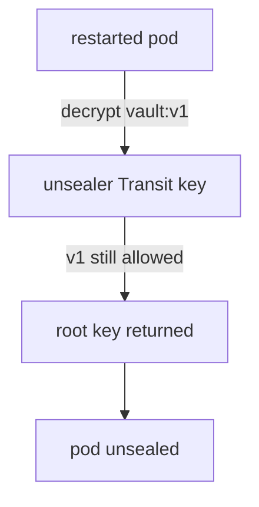

# Rotating The Transit Key

The Transit seal depends on one key that lives in another OpenBao server. Security teams rotate keys on a schedule, and a rotation of this key is a risk: if you rotate it the wrong way, the cluster can no longer unseal after its next restart. This part rotates the key in the playground and shows the one setting that must not be touched.

## Key versions

A key in the Transit secrets engine has numbered **versions**. When you rotate a key, the engine adds a new version and uses it for all new encryption. Old versions stay, so data that was encrypted earlier can still be decrypted. Two fields of the key matter here: `latest_version` is the version used to encrypt, and `min_decryption_version` is the oldest version that may still decrypt.

The playground cluster uses auto-unseal. A second OpenBao, the unsealer, holds the Transit key `autounseal`. Read its state, using the unsealer's lab-only root token:

<!-- astrona:playground:renew -->

```sh
export UNSEALER_TOKEN=$(kubectl -n unsealer get secret unsealer-init -o jsonpath='{.data.root-token}' | base64 -d)
unsealer_bao() { kubectl -n unsealer exec -i unsealer-0 -- env BAO_ADDR=http://127.0.0.1:8200 BAO_TOKEN="$UNSEALER_TOKEN" bao "$@"; }
unsealer_bao read transit/keys/autounseal
```

A new key has `latest_version` 1 and `min_decryption_version` 1. The output also lists each version with its creation time.

## What the seal stores

When the main cluster starts, it must decrypt its root key. It stores that root key in encrypted form, and it asks the unsealer to decrypt it through `transit/decrypt/autounseal`. The encrypted value carries the version of the key that encrypted it, in a prefix such as `vault:v1:`. The decrypt request works only while the unsealer still allows that version.

That is the rule for rotation: the stored root key may still be wrapped with an old version, so old versions must stay decryptable. Rotate with the dedicated endpoint:

```sh
unsealer_bao write -f transit/keys/autounseal/rotate
unsealer_bao read -field=latest_version transit/keys/autounseal
```

The key now has version 2 as `latest_version`. Nothing happens to the main cluster. Its pods keep running unsealed, and a pod that restarts decrypts its root key with version 1, which is still allowed.

## The setting not to change

`min_decryption_version` is the control that retires old versions. Raising it to 2 stops version 1 from decrypting. If the stored root key is still wrapped with version 1, the next pod that restarts cannot unseal, and the cluster cannot start after a full outage. Only raise it after you are sure nothing depends on the old versions, and keep a snapshot and the recovery keys before you try.

Prove that a restart still works after the rotation. Set up the helper for the main cluster, restart a standby and wait for it to unseal itself:

```sh
export BAO_TOKEN=$(kubectl -n openbao get secret openbao-init -o jsonpath='{.data.root-token}' | base64 -d)
bao_on() { pod=$1; shift; kubectl -n openbao exec -i "$pod" -- env BAO_ADDR=http://127.0.0.1:8200 BAO_TOKEN="$BAO_TOKEN" bao "$@"; }
bao_on openbao-0 operator raft list-peers
kubectl -n openbao delete pod openbao-2
sleep 30
bao_on openbao-2 status
```

If `openbao-2` was the leader, pick a standby from `list-peers` instead. The restarted pod reports `Sealed false` without any key from you. Because the unsealer still allows version 1, the stored root key could be decrypted.



The diagram shows that a restarted pod always asks the unsealer to decrypt with the version the root key was wrapped with.

You now know that rotating the Transit key adds a version without breaking the seal, and that `min_decryption_version` is the setting that can lock the cluster out. The next question is who is allowed to call the key.

## Common pitfalls

> [!WARNING]
> - **Raising `min_decryption_version` right after a rotation.** The stored root key may still need the old version, and the next restart fails.
> - **Rotating the key in the main cluster.** The Transit key lives in the unsealer. A Transit engine inside the cluster it unseals would be circular.
> - **Deleting the key.** Without it, the root key and every snapshot of the cluster are unusable.
> - **Testing only on a running pod.** A running pod does not need the key. Restart one pod to prove the seal works.

## Your mission: Rotate The Transit Key Safely

You can now rotate the Transit key and prove a restart still works. The graded lab gives you an auto-unsealed cluster and asks you to rotate the key without breaking the seal.

The lab runs in its own cluster, so first pause your playground. Nothing in it is lost:

```sh
astrona stop ats-117-playground-020-02
```

Then start the lab:

```sh
astrona run --git ssh://git@github.com/astrona-io/ATS117.git -c sections/section-020/module-02/labs/lab-01
```

The task is on the next page. Solve it on your own first. When you think you are done, send it for grading:

```sh
astrona submit -c sections/section-020/module-02/labs/lab-01
```

When the lab is done, remove it and start your playground again:

```sh
astrona destroy ats-117-lab-020-02
astrona start ats-117-playground-020-02
```
