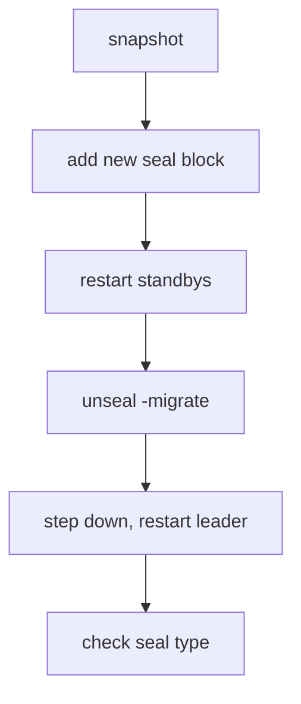

# Migration Paths And Seal Failures

A seal is not for ever. A team moves from Shamir to Transit, from Transit to a cloud KMS, or back. Each move uses the same tool, `unseal -migrate`, with a different starting point. This part lists the migration paths, and then makes a seal fail on purpose so you can read the symptoms.

## The migration paths

A migration changes the way the root key is protected. The data stays as it is. The recovery keys or unseal keys of the old seal authorize the move.

| From | To | What you do |
| --- | --- | --- |
| Shamir | Auto-unseal | Add the new `seal` block, restart standbys, run `bao operator unseal -migrate` with the unseal key on each, step the leader down and restart it |
| Auto-unseal | Shamir | Mark the old seal with `disabled = "true"`, restart, and run `bao operator unseal -migrate` with the recovery keys |
| Auto-unseal | Another auto-unseal | Keep the old seal block with `disabled = "true"`, add the new `seal` block, restart, and run `unseal -migrate` with the recovery keys |

The `disabled = "true"` setting tells the server that the block describes the seal it is leaving, so it can still decrypt the root key with it during the migration. The migration finishes when the active node completes it; the other nodes then follow the new seal. Take a snapshot before you start and keep the old key service until every node has restarted on the new one.



The diagram shows the order of an online migration: standbys first, the leader last.

## Reading a seal failure

Make the failure on purpose and read it. Scale the unsealer to zero, then restart one pod of the main cluster. The pod cannot reach its key service:

<!-- astrona:playground:renew -->

```sh
kubectl -n unsealer scale statefulset unsealer --replicas=0
kubectl -n openbao delete pod openbao-2
sleep 30
kubectl -n openbao logs openbao-2 --tail=20
kubectl -n openbao exec -i openbao-2 -- env BAO_ADDR=http://127.0.0.1:8200 bao status
```

If `openbao-2` was the leader, use a standby from `list-peers`. The pod is running. `bao status` shows `Sealed true`, and the log contains errors from the Transit seal about reaching the unsealer. The cluster itself keeps serving requests from the other two pods, which are still unsealed.

Bring the key service back and watch the pod recover:

```sh
kubectl -n unsealer scale statefulset unsealer --replicas=1
sleep 60
kubectl -n openbao exec -i openbao-2 -- env BAO_ADDR=http://127.0.0.1:8200 bao status
```

The unsealer unseals itself with its static key, and `openbao-2` retries until the key service answers. If the pod did not retry, delete it once more. This is the dependency of every auto-unseal: the key service must be up when a pod starts.

The three questions to ask on a sealed pod are the same in every environment. Is the key service reachable from the pod? Does the pod's credential still work? Does the key still exist and allow decryption? The log answers the first, a test request answers the second, and the key service answers the third.

You now know the three migration paths, why the old seal is marked `disabled` during a move, and how a missing key service looks. This closes the module on operating the seal.

## Common pitfalls

> [!WARNING]
> - **Migrating without a snapshot.** If the new seal is wrong, the snapshot is the way back.
> - **Removing the old seal block too early.** The server then cannot decrypt the root key during the move.
> - **Restarting the leader first.** Standbys first, then step down.
> - **Stopping the key service during a rolling restart.** Pods that restart in that time stay sealed.
