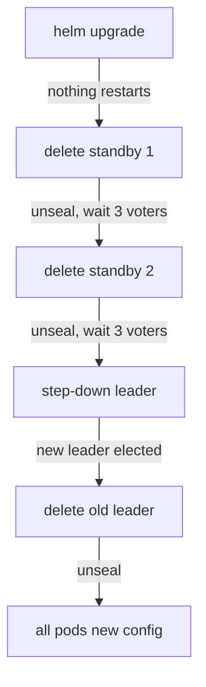

# Scraping Every Node With Prometheus

Prometheus pulls metrics from targets on a schedule. To see a sealed standby, every OpenBao pod must be its own target. This part writes the scrape job for the playground cluster, checks it in Prometheus, and then shows how to roll the telemetry configuration out to a cluster that does not have it yet.

## The scrape job

A scrape job tells Prometheus where to send requests and with which path and parameters. The pods of a StatefulSet have stable DNS names through the headless Service, so a static list of targets is enough here. Save this as `configmap-prometheus-config.yaml`:

<!-- astrona:playground:renew -->

```yaml
apiVersion: v1
kind: ConfigMap
metadata:
  name: prometheus-config
  namespace: monitoring
data:
  prometheus.yml: |
    global:
      scrape_interval: 15s
      evaluation_interval: 15s
    rule_files:
      - /etc/prometheus/rules/*.yml
    scrape_configs:
      - job_name: prometheus
        static_configs:
          - targets: ["localhost:9090"]
      - job_name: openbao
        metrics_path: /v1/sys/metrics
        params:
          format: ["prometheus"]
        static_configs:
          - targets:
              - openbao-0.openbao-internal.openbao.svc.cluster.local:8200
              - openbao-1.openbao-internal.openbao.svc.cluster.local:8200
              - openbao-2.openbao-internal.openbao.svc.cluster.local:8200
```

Apply it, and restart Prometheus so it reads the new file:

```sh
kubectl apply -f configmap-prometheus-config.yaml
kubectl -n monitoring rollout restart deployment/prometheus
kubectl -n monitoring rollout status deployment/prometheus
```

The `params` block adds `?format=prometheus` to every request. The OpenBao documentation points out that you cannot put the question mark in `metrics_path`: Prometheus would escape it. On a larger cluster you would discover the pods with Kubernetes service discovery instead of a static list; the result is the same.

## Checking the targets

Open Prometheus in a browser through a port-forward in a second terminal:

```sh
kubectl -n monitoring port-forward svc/prometheus 9090:9090
```

On `http://localhost:9090/targets`, the job `openbao` lists three targets. After one scrape interval each shows `UP`. Then run a query on the main page, or from the terminal:

```sh
kubectl -n clients exec -i deploy/tester -- \
  curl -s -G --data-urlencode 'query=vault_core_unsealed' http://prometheus.monitoring:9090/api/v1/query | jq '.data.result[] | {instance: .metric.instance, value: .value[1]}'
```

Three results, one per pod, each with the value `1`. Prometheus adds the `instance` label from the target address, so you can tell the pods apart in every query.

## Rolling telemetry out to a cluster that does not have it

The playground cluster started with telemetry on. A cluster without it needs the two settings in its Helm values, and then every pod must restart to read them. The StatefulSet uses the `OnDelete` update strategy, and every restarted pod comes back sealed with the Shamir seal, so the order matters:



The diagram shows the rolling restart: standbys one at a time, then the leader steps down and restarts last, so two voters always stay up.

The commands for one pod are the same each time. Here for `openbao-1`, with the helpers `bao_on` and the key from the Secret `openbao-init`:

```sh
export BAO_TOKEN=$(kubectl -n openbao get secret openbao-init -o jsonpath='{.data.root-token}' | base64 -d)
bao_on() { pod=$1; shift; kubectl -n openbao exec -i "$pod" -- env BAO_ADDR=http://127.0.0.1:8200 BAO_TOKEN="$BAO_TOKEN" bao "$@"; }
kubectl -n openbao delete pod openbao-1
sleep 20
bao_on openbao-1 operator unseal "$(kubectl -n openbao get secret openbao-init -o jsonpath='{.data.unseal-key}' | base64 -d)"
bao_on openbao-0 operator raft list-peers
```

For the leader, run `bao operator step-down` on it first, wait for a new leader, and then delete it. The playground does not need this now, because its pods already have telemetry; the graded lab does.

You now know how to make Prometheus scrape every pod with the right path and parameter, how to check the targets and query `vault_core_unsealed` per pod, and how to roll a configuration change through a Shamir cluster one pod at a time.

## Common pitfalls

> [!WARNING]
> - **Putting `?format=prometheus` in `metrics_path`.** Use `params`; Prometheus escapes the question mark in the path.
> - **Forgetting to restart Prometheus.** It reads the ConfigMap at start in this setup; the new job does not appear until the pod restarts.
> - **Restarting two OpenBao pods at once.** With three voters, two down means no quorum.
> - **Restarting the leader first.** Step it down and restart it last, so the cluster elects once instead of twice.

## Your mission: Scrape Every Node With Prometheus

You can now make every OpenBao node report to Prometheus. The graded lab gives you a cluster without telemetry and a Prometheus that scrapes the wrong thing, and asks for metrics from all three pods.

The lab runs in its own cluster, so first pause your playground. Nothing in it is lost:

```sh
astrona stop ats-117-playground-030-01
```

Then start the lab:

```sh
astrona run --git ssh://git@github.com/astrona-io/ATS117.git -c sections/section-030/module-01/labs/lab-01
```

The task is on the next page. Solve it on your own first. When you think you are done, send it for grading:

```sh
astrona submit -c sections/section-030/module-01/labs/lab-01
```

When the lab is done, remove it and start your playground again:

```sh
astrona destroy ats-117-lab-030-01
astrona start ats-117-playground-030-01
```
