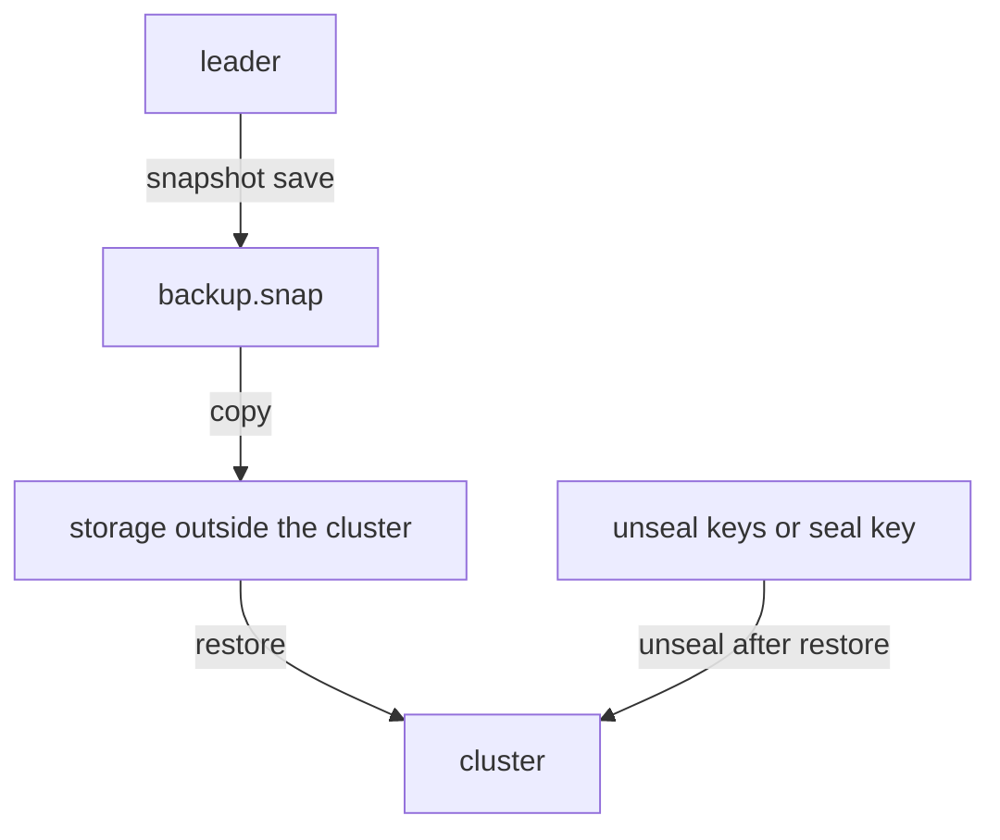

# Raft Snapshots

A backup is only a backup when it can be restored. This part saves a Raft snapshot of the playground cluster, takes it out of the cluster, and then looks at what the file holds and what else you need before it is worth anything.

## Saving a snapshot

A Raft snapshot is a point-in-time copy of all data in Integrated Storage: secrets, policies, auth methods, tokens, leases and OpenBao's own configuration. The leader writes it. Set up the helper, find the leader, and save a snapshot inside the leader pod:

<!-- astrona:playground:renew -->

```sh
export BAO_TOKEN=$(kubectl -n openbao get secret openbao-init -o jsonpath='{.data.root-token}' | base64 -d)
bao_on() { pod=$1; shift; kubectl -n openbao exec -i "$pod" -- env BAO_ADDR=http://127.0.0.1:8200 BAO_TOKEN="$BAO_TOKEN" bao "$@"; }
bao_on openbao-0 operator raft list-peers
bao_on openbao-0 operator raft snapshot save /tmp/backup.snap
```

Run the save on the leader; replace `openbao-0` if another pod leads. The command needs a token with permission on `sys/storage/raft/snapshot`; the lab uses the root token. The same snapshot is available over HTTP with a `GET` on `/v1/sys/storage/raft/snapshot`, which is what backup tools use.

A file inside a pod is not a backup: it disappears with the pod. Copy it to your machine:

```sh
kubectl -n openbao exec -i openbao-0 -- cat /tmp/backup.snap > backup.snap
ls -l backup.snap
```

From your machine you could also save it directly, through the port-forward, with `bao operator raft snapshot save backup.snap`. Either way, the file then goes to storage outside the cluster, such as object storage in another region.

## What is in the file

The snapshot holds OpenBao's storage exactly as Raft keeps it: encrypted with the cluster's keyring. Nobody can read a secret from the file alone. That is good for a file that sits in object storage, and it has a consequence: to use the snapshot you need what unseals the cluster that made it.

| The cluster used | You need, to restore and unseal |
| --- | --- |
| Shamir seal | Enough of the original unseal key shares |
| An auto-unseal seal | The same key in the same key service (the Transit key, the KMS key, the static key) |

Keep that pairing in your backup plan. A snapshot without the matching keys cannot be used, and a key service with a deleted key turns every snapshot made with it into noise. Store the keys and the snapshots in different places, with different access, so one compromised location gives an attacker neither.



The diagram shows that a restore needs two things that are kept apart: the snapshot file and the keys that unseal the cluster.

## How often

A snapshot is cheap: it reads Raft's data once. Teams take them on a schedule, often every hour, keep several, and take an extra one before any risky change: a seal migration, an upgrade, a large clean-up of secrets. The time between snapshots is the amount of data you can lose.

You now know how to save a snapshot on the leader, get it out of the cluster, and why it is useless without the keys of the cluster that made it. The open question is what happens to the cluster when you restore one.

## Common pitfalls

> [!WARNING]
> - **Leaving the snapshot in the pod.** `/tmp` disappears with the pod. Copy the file out at once.
> - **Storing the snapshot next to the unseal keys.** Whoever gets both gets every secret. Keep them apart.
> - **Deleting an old Transit or KMS key version.** Snapshots made with it can no longer be unsealed.
> - **Treating three nodes as a backup.** Raft replicates mistakes as faithfully as data.
