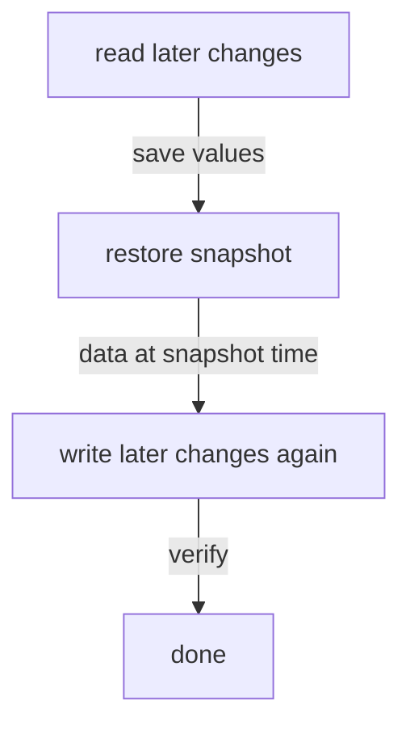

# Restoring A Snapshot

A restore is a big hammer. It does not put back one secret; it puts the whole cluster back to the moment of the snapshot. This part restores a snapshot into the running playground cluster, shows what that rolls back, and how to keep the changes made after the snapshot.

## The mistake

Take a snapshot first, then make a change you will want to undo, and one you will want to keep:

<!-- astrona:playground:renew -->

```sh
export BAO_TOKEN=$(kubectl -n openbao get secret openbao-init -o jsonpath='{.data.root-token}' | base64 -d)
bao_on() { pod=$1; shift; kubectl -n openbao exec -i "$pod" -- env BAO_ADDR=http://127.0.0.1:8200 BAO_TOKEN="$BAO_TOKEN" bao "$@"; }
bao_on openbao-0 operator raft snapshot save /tmp/before.snap
bao_on openbao-0 kv metadata delete secret/payments/db
bao_on openbao-0 kv put secret/payments/api key=written-after-the-snapshot
bao_on openbao-0 kv get secret/payments/db
```

Run these on the leader. `kv metadata delete` removes a KV version 2 secret with all its versions, so there is nothing to undelete. The last command reports that no value is found.

## The restore

Restore the snapshot on the leader:

```sh
bao_on openbao-0 operator raft snapshot restore /tmp/before.snap
```

The leader installs the snapshot and replicates it to the followers, and the cluster's data is now the data of the moment the snapshot was taken. The restore checks that the snapshot was made with the same keys as the running cluster; here it was, so the cluster stays unsealed. Check both secrets:

```sh
bao_on openbao-0 kv get secret/payments/db
bao_on openbao-0 kv get secret/payments/api
```

`secret/payments/db` is back. `secret/payments/api` is gone: it was written after the snapshot, and the restore rolled it back like everything else. The same happens to tokens issued, leases created and policies changed since the snapshot.

## Keeping later changes

The way to keep later changes is to read them before the restore and write them again afterwards. In a real incident that means three steps:

1. Find out what changed since the snapshot. The audit log, if one is on, records every write; otherwise ask the teams that use the affected paths.
2. Read the values that must survive, and save them somewhere safe for the next few minutes.
3. Restore, then write those values again.



The diagram shows the order: reading the later changes must happen before the restore, because the restore deletes them.

Tokens and leases issued after the snapshot cannot be written back this way. Their holders must log in again or request new secrets.

## When `-force` applies

`bao operator raft snapshot restore -force` skips the check that the snapshot's keys match the running cluster's seal or Shamir keys. It exists for disaster recovery into a different cluster, for example a newly initialized one, when you know you have the original keys. Use it on the wrong cluster and the nodes end up with data they cannot decrypt. Without a very specific reason, a restore that refuses because of the keys is telling you to stop.

You now know how a restore works: it replaces the cluster's data with the snapshot, keeps the cluster unsealed when the keys match, and rolls back everything written since. You also know how to keep those later changes, and why `-force` is for disasters only.

## Common pitfalls

> [!WARNING]
> - **Restoring to fix one secret without thinking.** Everything written since the snapshot is lost, including tokens and leases.
> - **Reading later changes after the restore.** They are already gone. Read first.
> - **Using `-force` because a restore refused.** The refusal means the keys do not match.
> - **Restoring on a standby.** Run the restore against the active node.

## Your mission: Restore A Deleted Secret From A Snapshot

You can now restore a snapshot and keep the changes made after it. The graded lab gives you a cluster where a secret was deleted after the nightly snapshot, and one legitimate change made after it that must survive.

The lab runs in its own cluster, so first pause your playground. Nothing in it is lost:

```sh
astrona stop ats-117-playground-040-01
```

Then start the lab:

```sh
astrona run --git ssh://git@github.com/astrona-io/ATS117.git -c sections/section-040/module-01/labs/lab-01
```

The task is on the next page. Solve it on your own first. When you think you are done, send it for grading:

```sh
astrona submit -c sections/section-040/module-01/labs/lab-01
```

When the lab is done, remove it and start your playground again:

```sh
astrona destroy ats-117-lab-040-01
astrona start ats-117-playground-040-01
```
