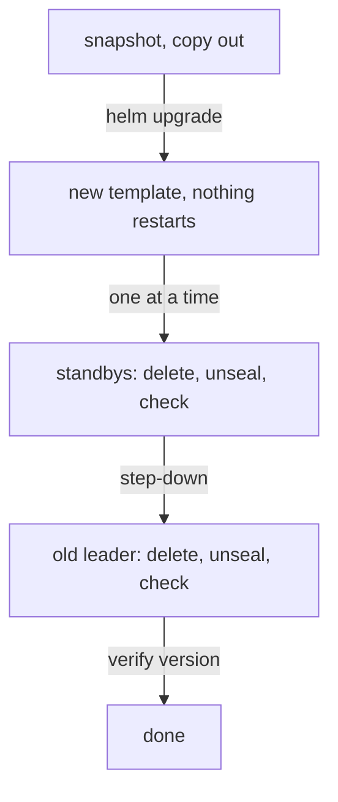

# Rolling Upgrades

OpenBao releases patch versions every few weeks, often with security fixes. Upgrading a three-node cluster means replacing the binary on every node without ever having two nodes down at once. This part shows how the Helm chart's `OnDelete` strategy puts you in control of that order, and the order itself.

## Why OnDelete

A StatefulSet can replace its pods by itself when the pod template changes (`RollingUpdate`), or wait until you delete each pod (`OnDelete`). The `openbao` Helm chart uses `OnDelete` by default. Check it:

<!-- astrona:playground:renew -->

```sh
kubectl -n openbao get statefulset openbao -o jsonpath='{.spec.updateStrategy.type}{"\n"}'
```

The answer is `OnDelete`. With the Shamir seal, an automatic rolling update would restart a pod, wait for it to be Ready, and stall, because a sealed pod is never Ready. With `OnDelete`, `helm upgrade` only changes the template, and you decide when each pod restarts, unseal it, and check the cluster before the next one.

## The order

The OpenBao upgrade advice for a cluster comes down to four steps:

1. **Take a snapshot** and copy it out of the cluster. If the new version has a problem with your data, this is the way back.
2. **Upgrade the standbys first**, one at a time. Delete a standby, let it start with the new image, unseal it, and wait until it is a voter again.
3. **Step the leader down.** One of the upgraded standbys becomes the leader.
4. **Upgrade the old leader last**, the same way.



The diagram shows the upgrade order: the leader is upgraded last, after a planned step-down, so the cluster elects a new leader only once.

Upgrading the leader last matters because a newer node can usually follow an older leader, while the leader writes data in its own version's format. During the upgrade, the cluster runs mixed versions for a few minutes; that is expected.

## Upgrading the playground

The playground runs 2.7.1, the version this course uses, so there is no newer version to move to. The commands are the same for any version; here they move to 2.7.1 explicitly, which changes nothing but shows each step. First the template:

```sh
helm upgrade openbao openbao/openbao --version 0.30.4 -n openbao --reuse-values --set server.image.tag=2.7.1
```

Then one standby, here `openbao-1`:

```sh
export BAO_TOKEN=$(kubectl -n openbao get secret openbao-init -o jsonpath='{.data.root-token}' | base64 -d)
bao_on() { pod=$1; shift; kubectl -n openbao exec -i "$pod" -- env BAO_ADDR=http://127.0.0.1:8200 BAO_TOKEN="$BAO_TOKEN" bao "$@"; }
kubectl -n openbao delete pod openbao-1
sleep 20
bao_on openbao-1 operator unseal "$(kubectl -n openbao get secret openbao-init -o jsonpath='{.data.unseal-key}' | base64 -d)"
bao_on openbao-1 status
```

`bao status` prints the node's `Version`. Check `kubectl -n openbao get pod openbao-1 -o jsonpath='{.spec.containers[0].image}'` too: the image tag is the one from the template. Repeat for the other standby, then step the leader down with `bao operator step-down` and restart it last.

OpenBao records each version a cluster has run. `bao read sys/version-history` lists them with the time each version was first seen, which is useful to prove when an upgrade happened.

## Upgrades with auto-unseal

With an auto-unseal seal, each restarted pod unseals itself, so the steps are shorter: delete, wait until it is unsealed and a voter, next. The order does not change. The key service must be reachable during the whole upgrade; check it before you start.

You now know why the chart uses `OnDelete`, the four-step order of an upgrade, and how to verify each pod's version. The same rolling restart applies to any change of the server configuration.

## Common pitfalls

> [!WARNING]
> - **Upgrading without a fresh snapshot.** If the new version misbehaves with your data, there is no clean way back.
> - **Deleting all pods after `helm upgrade`.** The cluster loses quorum, and with Shamir every pod needs unsealing at once.
> - **Upgrading the leader first.** The cluster elects twice, and old standbys follow a newer leader.
> - **Skipping the check between pods.** Wait for three voters before the next restart.
